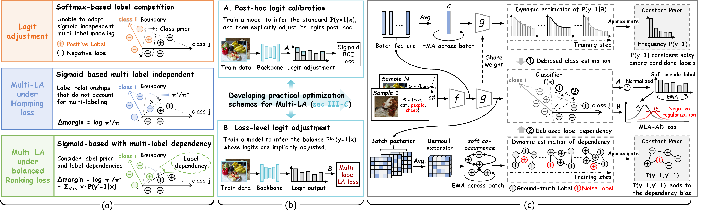

# ProDepC

<p align="center">
  <b>Prototype-Based and Dependency-Aware Calibrated Multi-Label Logit Adjustment<br>
  for Long-Tailed Partial Multi-Label Classification</b>
</p>

<p align="center">
  Jingyu Zhong · Ronghua Shang · Shasha Mao · Jie Feng
</p>

<p align="center">
  Official PyTorch implementation of <b>ProDepC</b>.
</p>

---

## Overview

Real-world multi-label data often exhibit two difficulties simultaneously: **candidate-label ambiguity** and **long-tailed class imbalance**. Their coexistence makes tail classes particularly vulnerable to noisy supervision and also makes class-prior estimation unreliable.

ProDepC addresses this setting through a **Multi-Label Logit Adjustment (Multi-LA)** framework derived for independent sigmoid-based multi-label modeling. The method combines:

- **Prototype-based class-prior estimation** for robust online estimation of marginal label frequencies;
- **Prediction-driven dependency estimation** for modeling label-conditional relationships without clean joint annotations;
- **Multi-LA-based posterior calibration** for more balanced candidate-label disambiguation;
- **Multi-LA-based asymmetric disambiguation (MLA-AD) loss** for suppressing unreliable negative supervision while strengthening tail-class learning.

<p align="center">
  
</p>

The current code release focuses on the main **VOC-PMLT** and **COCO-PMLT** experiments.

---

## Highlights

- A Multi-LA formulation compatible with **independent sigmoid multi-label prediction**.
- Online class-prior estimation from a global prototype feature.
- Online label-dependency estimation from soft prediction statistics.
- Dynamic pseudo-label calibration for partial multi-label disambiguation.
- Lightweight training overhead: no extra network branch or additional pass over the training set.

---

## Repository Structure

```text
ProDepC/
├── assets/
│   └── framework.png              # Method overview
├── configs/
│   ├── voc/
│   │   └── LT_resnet50_pfc_DB.py
│   └── coco/
│       └── LT_resnet50_pfc_DB.py
├── data/
│   ├── voc/                       # VOC split metadata and LT statistics
│   └── coco/                      # COCO split metadata and LT statistics
├── mllt/                          # Model, dataset, loss, and evaluation infrastructure
├── pre-processed-data/            # Pre-generated partial-label files
├── utils/
│   └── PML_Confidence.py          # Core ProDepC implementation
├── create_longtail_dataset.py     # Long-tailed split construction utility
├── train_ours.py                  # Training entry point
├── test.py                        # Evaluation entry point
└── test_each_class.py             # Per-class evaluation utility
```

The main ProDepC logic is implemented in [`utils/PML_Confidence.py`](utils/PML_Confidence.py).

---

## Requirements

The codebase uses the MMCV 1.x training API and was developed with Python 3.8-era dependencies. A legacy PyTorch/MMCV environment is recommended.

### Core dependencies

- Python 3.8
- PyTorch and torchvision with CUDA support
- MMCV 1.x (`mmcv-full` for GPU execution)
- NumPy
- SciPy
- scikit-learn
- pandas
- Pillow
- tqdm
- matplotlib
- OpenCV
- pycocotools
- terminaltables

Additional modules imported by auxiliary code include `timm`, `torchmetrics`, `pynvml`, `lvis`, and `inplace_abn`. The main data loader also imports the OpenAI `clip` package; install it or remove the unused `import clip` line in `utils/imagelist.py`.

A typical environment can be created as follows:

```bash
conda create -n prodepc python=3.8 -y
conda activate prodepc

# Install a PyTorch/torchvision build compatible with your CUDA version first.
# Then install MMCV 1.x and the remaining dependencies.

pip install numpy scipy scikit-learn pandas pillow tqdm matplotlib \
            opencv-python pycocotools terminaltables timm torchmetrics pynvml lvis

# Required by the current utils/imagelist.py import
pip install git+https://github.com/openai/CLIP.git
```

> **Important:** MMCV 2.x is not directly compatible with the APIs used in this repository. Use an MMCV 1.x release that matches your PyTorch/CUDA environment.

---

## Dataset Preparation

### 1. VOC-PMLT

The training split is constructed from **Pascal VOC 2012**, while evaluation uses the **Pascal VOC 2007 test set**.

Expected structure:

```text
data/voc/
├── VOCdevkit/
│   ├── VOC2007/
│   │   ├── Annotations/
│   │   ├── ImageSets/
│   │   └── JPEGImages/
│   └── VOC2012/
│       ├── Annotations/
│       ├── ImageSets/
│       └── JPEGImages/
├── longtail2012/
├── voc_labels.txt
├── voc_lt_train.txt
└── voc_lt_test.txt
```

The repository already contains the long-tailed split metadata and pre-generated partial-label files for the reported noise settings.

Reported VOC-PMLT settings:

| Training images | Classes | Noise rates | Test images |
|---|---|---|---|
| 1,142 | 20 | 0.1 / 0.3 / 0.5 | 4,952 |

### 2. COCO-PMLT

Place MS-COCO 2017 in the following structure:

```text
data/coco/
├── annotations/
│   ├── instances_train2017.json
│   └── instances_val2017.json
├── train2017/
├── val2017/
├── longtail2017/
├── coco_labels.txt
├── coco_lt_train.txt
└── coco_lt_test.txt
```

Then edit the following line in [`configs/coco/LT_resnet50_pfc_DB.py`](configs/coco/LT_resnet50_pfc_DB.py):

```python
data_root = './data/coco/'
```

The original configuration contains a local absolute path and must be changed before running on another machine.

Reported COCO-PMLT settings:

| Training images | Classes | Noise rates | Test images |
|---|---|---|---|
| 1,909 | 80 | 0.05 / 0.1 / 0.2 | 5,000 |

### Candidate-label files

During training, the code loads candidate-label files from `pre-processed-data/`, for example:

```text
voc-lt_0.1_sd0.npy
voc-lt_0.3_sd0.npy
voc-lt_0.5_sd0.npy
coco-lt_0.05_sd0.npy
coco-lt_0.1_sd0.npy
coco-lt_0.2_sd0.npy
```

If a requested file does not exist, `data/datasets.py` automatically generates it from the clean labels using the specified noise rate and seed.

---

## Training

Create the checkpoint directory first:

```bash
mkdir -p checkpoint
```

### VOC-PMLT

Example for noise rate `rho = 0.1`:

```bash
python train_ours.py \
  --config ./configs/voc/LT_resnet50_pfc_DB.py \
  --dataset voc-lt \
  --partial_rate 0.1 \
  --epochs 10 \
  --mu_range 0.9,0.99 \
  --m 0.9 \
  --phi 0.9 \
  --tau 2.0 \
  --beta 1.0 \
  --seed 0 \
  --gpus 1
```

For the other reported settings, change:

```bash
--partial_rate 0.3
--partial_rate 0.5
```

### COCO-PMLT

Example for noise rate `rho = 0.05`:

```bash
python train_ours.py \
  --config ./configs/coco/LT_resnet50_pfc_DB.py \
  --dataset coco-lt \
  --partial_rate 0.05 \
  --epochs 10 \
  --mu_range 0.99,0.999 \
  --m 0.99 \
  --phi 0.9 \
  --tau 2.0 \
  --beta 2.0 \
  --seed 0 \
  --gpus 1
```

### Recommended dataset-specific settings

The parameter analysis in the paper suggests the following settings for the main reported LT-PML results:

| Dataset | `mu_range` | `m` | `phi` | `beta` |
|:---|:---:|:---:|:---:|:---:|
| VOC-PMLT | `0.9,0.99` | `0.9` | `0.9` | `1.0` |
| COCO-PMLT | `0.99,0.999` | `0.99` | `0.9` | `2.0` |

The prior-adjustment scale `tau` performs best in a moderate range around the repository default; the example commands use `2.0`.

### Main hyperparameters

| Argument | Meaning | Default in code |
|:---|:---|:---:|
| `--mu_range` | Start/end momentum for pseudo-label updates | `0.9,0.99` |
| `--m` | Prototype feature momentum | `0.9` |
| `--phi` | Soft co-occurrence momentum | `0.9` |
| `--tau` | Class-prior adjustment strength | `2.0` |
| `--beta` | Label-dependency correction strength | `1.5` |
| `--epochs` | Number of training epochs | `10` |
| `--seed` | Random seed | `0` |

The backbone is ImageNet-pretrained **ResNet-50**. The implementation uses a 2048-to-256 projection layer and a 256-to-C classifier. Training uses batch size 32, 224x224 inputs, SGD with momentum 0.9 and weight decay `1e-4`, and linear warm-up during the first 500 iterations.

The asymmetric negative regularization scale is set internally to:

- `5` for VOC-PMLT;
- `2` for COCO-PMLT.

---

## Evaluation

Evaluate a saved checkpoint with:

```bash
python test.py \
  --config ./configs/voc/LT_resnet50_pfc_DB.py \
  --checkpoint ./checkpoint/your_checkpoint.pth \
  --eval multiple
```

For COCO-PMLT:

```bash
python test.py \
  --config ./configs/coco/LT_resnet50_pfc_DB.py \
  --checkpoint ./checkpoint/your_checkpoint.pth \
  --eval multiple
```

The evaluation script reports performance for the **Head**, **Middle**, **Tail**, and **Total** class groups, including mAP, accuracy, micro-F1, and macro-F1.

To print the standard mAP evaluation:

```bash
python test.py \
  --config ./configs/voc/LT_resnet50_pfc_DB.py \
  --checkpoint ./checkpoint/your_checkpoint.pth \
  --eval mAP
```

---

## Main Results

Total mAP (%) reported in the paper:

| Dataset | Noise rate | ProDepC-HL | ProDepC |
|:---：|:---:|：---:|：---:|
| VOC-PMLT | 0.1 | 71.53 | **72.30** |
| VOC-PMLT | 0.3 | 60.60 | **61.49** |
| VOC-PMLT | 0.5 | 41.15 | **42.26** |
| COCO-PMLT | 0.05 | 42.83 | **43.89** |
| COCO-PMLT | 0.1 | 37.19 | **38.46** |
| COCO-PMLT | 0.2 | 31.62 | **32.87** |

Across the reported LT-PML benchmarks, ProDepC improves over the strongest competing methods by up to **9.06 percentage points in total mAP** and **9.13 percentage points in tail-class mAP**.

Results may vary slightly with hardware, CUDA/cuDNN versions, and random initialization. The paper reports five runs for the synthetic benchmark experiments.

## Citation

Please cite the paper when using this code. The final bibliographic information can be updated after publication.

```bibtex
@article{zhong2026prodepc,
  title   = {Prototype-Based and Dependency-Aware Calibrated Multi-Label Logit Adjustment for Long-Tailed Partial Multi-Label Classification},
  author  = {Zhong, Jingyu and Shang, Ronghua and Mao, Shasha and Feng, Jie},
  year    = {2026},
  note    = {Manuscript}
}
```

---

## Acknowledgements

This implementation uses components from the long-tailed multi-label learning infrastructure associated with **Distribution-Balanced Loss**, together with **MMCV**-style model, dataset, and evaluation utilities. We thank the authors of the related open-source projects.

---

## Contact

For questions about the paper or code, please open a GitHub issue.

